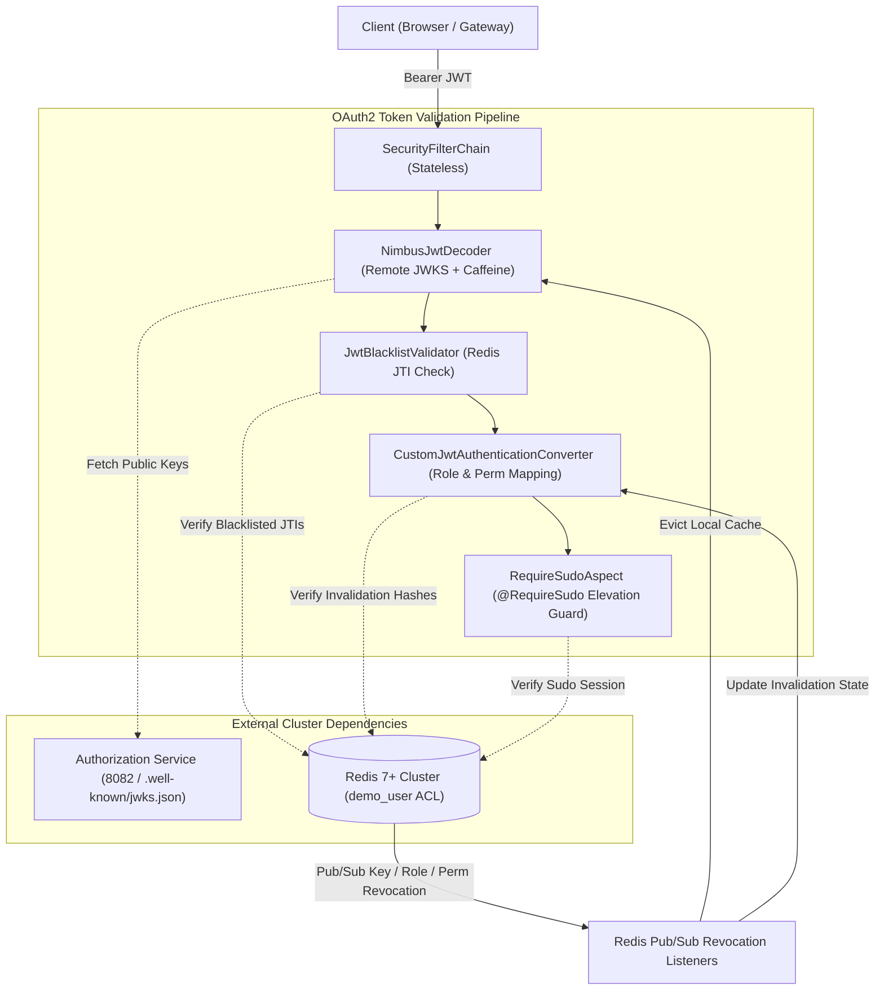

# Vaultix Demo Resource Server

[](https://openjdk.org/)
[](https://spring.io/projects/spring-boot)
[](https://spring.io/projects/spring-cloud)
[](https://openjdk.org/jeps/444)
[](https://opensource.org/licenses/Apache-2.0)

A reference microservice implementation demonstrating how downstream resource servers in the **Vaultix** distributed ecosystem integrate with **Spring Security OAuth2 Resource Server**, **Java 27 Virtual Threads** (Project Loom), and the shared **`com.vaultix:common`** core library.

---

## Service Overview

| Attribute | Specification |
| :--- | :--- |
| **Port** | `8083` |
| **Context Path** | `/api/v1/demo` |
| **Service Application Name** | `demo` |
| **Framework** | Spring Boot `4.1.2` / Spring Cloud `2025.1.4` (`spring-boot-starter-oauth2-resource-server`) |
| **Runtime** | Java 27 (OpenJDK / Amazon Corretto 27) with Virtual Threads enabled |
| **Discovery** | Eureka Client (`http://localhost:8761/eureka/`) |
| **Security Mode** | Stateless OAuth2 Resource Server (`JWT`) |
| **Cache & Pub/Sub** | Redis 7+ (Least-privilege ACL user: `demo_user`) |

---

## Architectural Role in Vaultix

The **Demo Resource Server** acts as the blueprint for any business microservice deployed in the Vaultix cluster. It demonstrates end-to-end token validation, distributed cache invalidation, least-privilege Redis permissions, and step-up sudo enforcement:



---

## Directory Structure

```text
demo/
├── pom.xml                                    /* Spring Boot 4.1.2, Spring Cloud 2025.1.4, common */
├── README.md                                  /* Reference runbook and overview */
├── .env.example                               /* Template environment variables */
├── docs/
│   └── ARCHITECTURE.md                        /* Comprehensive integration manual */
└── src/main/
    ├── java/com/example/demo/
    │   ├── DemoApplication.java               /* Application bootstrap class */
    │   └── config/
    │       ├── JwtDecoderConfig.java          /* Remote JWKS decoder with Caffeine L1 cache */
    │       ├── RedisPubSubConfig.java         /* Pub/Sub invalidation topic listeners */
    │       ├── SecurityBeansConfig.java       /* Blacklist, revocation & sudo bean definitions */
    │       ├── SecurityConfig.java            /* Stateless SecurityFilterChain configuration */
    │       └── properties/
    │           └── JwtProperties.java         /* Immutable record binding vaultix.jwt */
    └── resources/
        └── application.yaml                   /* Redis ACL, Eureka, and JWT decoder settings */
```

---

## Configuration Reference (`application.yaml`)

| Environment Variable | Default Value | Description |
| :--- | :--- | :--- |
| `PORT` | `8083` | HTTP server port |
| `EUREKA_CLIENT_SERVICE_URL_DEFAULTZONE` | `http://localhost:8761/eureka/` | Discovery service registry URL |
| `VAULTIX_JWT_ISSUER` | `https://auth.vaultix.com` | Expected JWT issuer claim (`iss`) |
| `VAULTIX_JWT_JWK_SET_URI` | `http://localhost:8082/api/v1/auth/.well-known/jwks.json` | Remote JWKS discovery endpoint |
| `SPRING_DATA_REDIS_HOST` | `localhost` | Redis server hostname |
| `SPRING_DATA_REDIS_PORT` | `6379` | Redis server port |
| `SPRING_DATA_REDIS_USERNAME` | `demo_user` | Least-privilege Redis ACL username |
| `SPRING_DATA_REDIS_PASSWORD` | `demo_password` | Redis ACL password |

---

## Core Security Features Implemented

1. **Stateless Remote JWKS Decoding**: Decodes RSA-2048 JWT tokens minted by the Authorization service using `CommonJwtDecoderFactory` with a local 5-minute **Caffeine L1 Cache** (`jwk-set-cache`).
2. **Instant Token Blacklisting**: Validates the `jti` of every incoming JWT against Redis before dispatching to controller endpoints using `JwtBlacklistValidator`.
3. **Dynamic Role & Permission Revocations**: Maps custom `roles_permissions` claims into Spring Security `GrantedAuthority` objects (`ROLE_*` and `PERM_*`), automatically stripping revoked authorities on the fly.
4. **Real-Time Pub/Sub Invalidation**: Subscribes to `auth:signing-key:revocation`, `auth:permission:revocation`, and `auth:role:revocation` via `RedisPubSubHelper` for instant cache eviction.
5. **Least-Privilege Redis ACL Model**: Runs under `demo_user` credentials with read-only access to revocation hashes and write access restricted strictly to `demo:*`.
6. **Step-Up Sudo Protection**: Configures `RequireSudoAspect` and `RedisSudoService` to verify elevated sessions (`auth:sudo:session:<sessionId>`).

---

## Local Build & Execution

### 1. Build
```powershell
.\mvnw.cmd clean package
```

### 2. Run
```powershell
.\mvnw.cmd spring-boot:run
```

Once running, the service registers with Eureka as `DEMO` and listens at `http://localhost:8083/api/v1/demo`.

---

## In-Depth Documentation

For full technical specifications on Redis ACL permissions, remote Nimbus JWKS caching, and distributed revocation listeners, see:

👉 [**Security Architecture & Integration Manual (docs/ARCHITECTURE.md)**](docs/ARCHITECTURE.md)
