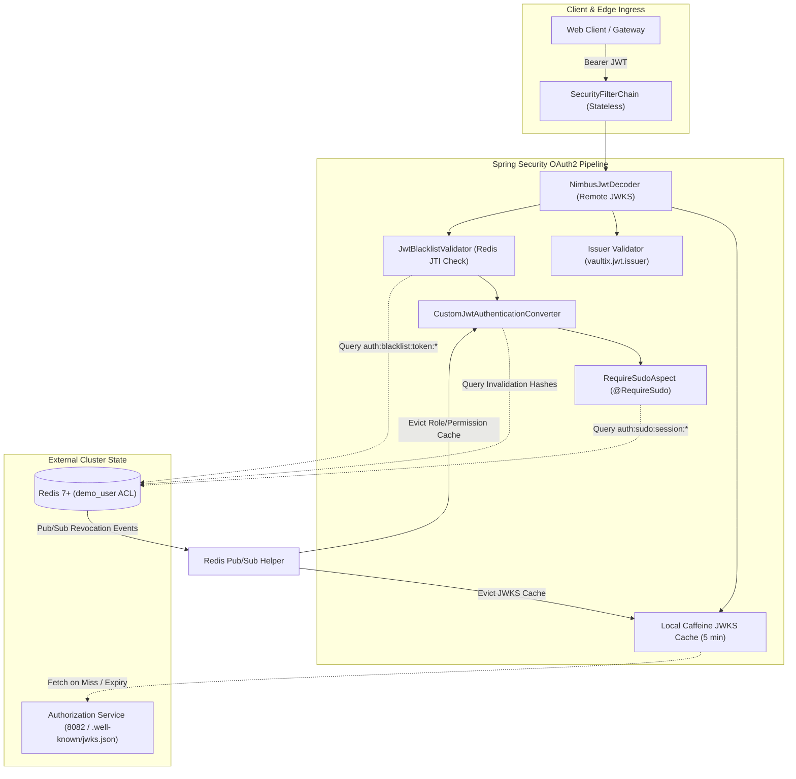
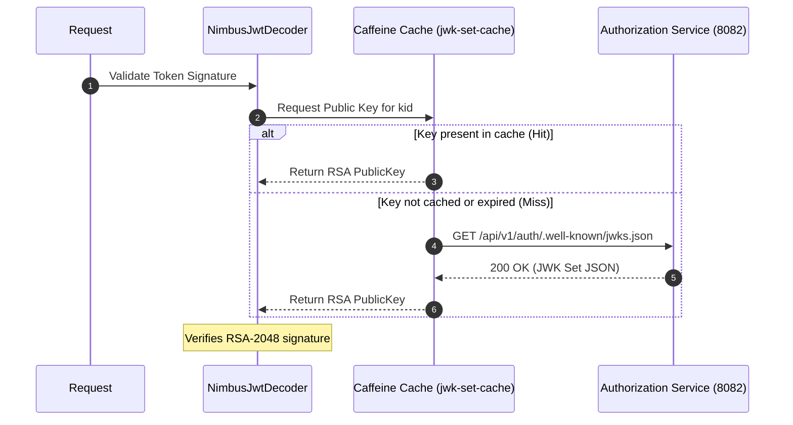
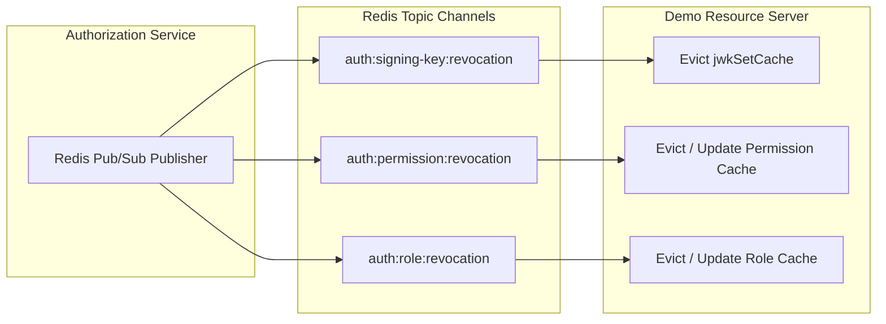

# Vaultix Demo Resource Server - Security Architecture & Integration

Technical specification and comprehensive architectural manual detailing how downstream resource servers integrate with the **Vaultix** security ecosystem using the shared `com.vaultix:common` core library, remote Nimbus JWKS decoding, and Redis Pub/Sub revocation.

---

## Table of Contents
1. [Architecture Overview & Ecosystem Role](#1-architecture-overview--ecosystem-role)
2. [Stateless Security Filter Chain](#2-stateless-security-filter-chain)
3. [Remote JWKS Decoding with Local Caching (`JwtDecoderConfig`)](#3-remote-jwks-decoding-with-local-caching-jwtdecoderconfig)
4. [Real-Time Token Blacklisting (`JwtBlacklistValidator`)](#4-real-time-token-blacklisting-jwtblacklistvalidator)
5. [Dynamic Authority Mapping & Live Revocations](#5-dynamic-authority-mapping--live-revocations)
6. [Distributed Invalidation via Redis Pub/Sub](#6-distributed-invalidation-via-redis-pubsub)
7. [Elevated Sudo Mode Verification (`RequireSudoAspect`)](#7-elevated-sudo-mode-verification-requiresudoaspect)
8. [Least-Privilege Redis ACL Architecture (`demo_user`)](#8-least-privilege-redis-acl-architecture-demo_user)
9. [Standardized Error Envelopes](#9-standardized-error-envelopes)

---

## 1. Architecture Overview & Ecosystem Role

The **Demo Resource Server** is the canonical architectural reference implementation for building secure, stateless backend microservices in the Vaultix cluster:



---

## 2. Stateless Security Filter Chain

Configured in `SecurityConfig.java`:

```java
@Bean
public SecurityFilterChain securityFilterChain(
        HttpSecurity http,
        JwtDecoder jwtDecoder,
        CustomJwtAuthenticationConverter authenticationConverter) throws Exception {

    http
        .csrf(AbstractHttpConfigurer::disable)
        .sessionManagement(session -> session.sessionCreationPolicy(SessionCreationPolicy.STATELESS))
        .authorizeHttpRequests(auth -> auth
            .requestMatchers("/public/**", "/actuator/health").permitAll()
            .anyRequest().authenticated()
        )
        .oauth2ResourceServer(oauth2 -> oauth2
            .jwt(jwt -> jwt
                .decoder(jwtDecoder)
                .jwtAuthenticationConverter(authenticationConverter)
            )
            .authenticationEntryPoint(new CustomAuthenticationEntryPoint())
            .accessDeniedHandler(new CustomAccessDeniedHandler())
        );

    return http.build();
}
```

### Key Architectural Characteristics:
* **`SessionCreationPolicy.STATELESS`**: Disables `HttpSession` and `JSESSIONID` cookies entirely. Every request is verified purely against the cryptographically signed JWT.
* **`CustomAuthenticationEntryPoint` & `CustomAccessDeniedHandler`**: Intercept authentication failures (401) and authorization rejections (403), formatting them as uniform `ApiResponse.error(...)` envelopes while masking internal server error details.

---

## 3. Remote JWKS Decoding with Local Caching (`JwtDecoderConfig`)

Configured using `CommonJwtDecoderFactory.withJwkSetUri()` from `com.vaultix:common`:



### Rationale:
* **Local Caffeine L1 Cache**: Caches the JWK Set locally for 5 minutes (`expireAfterWrite(5, TimeUnit.MINUTES)`). This prevents high-throughput microservices from creating HTTP bottlenecks against the Authorization service.
* **Expected Issuer Validation**: Enforces that the `iss` claim strictly matches `vaultix.jwt.issuer` (`https://auth.vaultix.com`), preventing cross-environment token injection attacks.

---

## 4. Real-Time Token Blacklisting (`JwtBlacklistValidator`)

Wired into the `NimbusJwtDecoder` validator pipeline before controller dispatch:
* Extracts the token's unique identifier (`jti` claim).
* Queries the Redis token blacklist via `TokenBlacklistService.isBlacklisted(jti)` (`auth:blacklist:token:<jti>`).
* If blacklisted (e.g. following a user logout or session termination), the token is rejected immediately with an `invalid_token` error.

---

## 5. Dynamic Authority Mapping & Live Revocations

`CustomJwtAuthenticationConverter` transforms the custom `roles_permissions` claims into Spring Security `GrantedAuthority` collections:
* **Claim Structure**:
  ```json
  "roles_permissions": {
    "ROLE_ADMIN": ["user:create", "user:read", "user:update", "user:delete"],
    "ROLE_USER": ["profile:read", "profile:update"]
  }
  ```
* **Live Invalidation Check**:
  - Compares the token's issued-at timestamp (`iat`) against `RoleRevocationService.isRevoked(roleName, iat)` and `PermissionRevocationService.isRevoked(permName, iat)`.
  - If an administrator revoked a role or permission after the token was minted, the authority is stripped on the fly without waiting for access token expiration.
* **Actor Principal**: Extracts the actor UUID from the `sub` claim as the authenticated principal.

---

## 6. Distributed Invalidation via Redis Pub/Sub

To ensure immediate consistency across microservices, `RedisPubSubConfig` binds typed message listeners to platform security channels using `RedisPubSubHelper`:



### Synchronization Architecture:
1. **Startup Synchronization**: Implements Spring's `ApplicationRunner` to load active revocations from Redis hashes (`auth:permissions:revocations`, `auth:roles:revocations`) on application boot.
2. **Real-Time Invalidation**: When a revocation event arrives on a Redis topic, the local Caffeine L1 cache is evicted or updated within milliseconds.

---

## 7. Elevated Sudo Mode Verification (`RequireSudoAspect`)

Configured in `SecurityBeansConfig.java`:
* Registers `RedisSudoService` reading active sudo elevation records from `auth:sudo:session:<sessionId>`.
* Registers `RequireSudoAspect` enforcing `@RequireSudo` annotations on controller methods.
* Evaluates elevation freshness in constant-time integer arithmetic. If unauthenticated or expired, halts execution with `SudoRequiredException` (HTTP 403 with `X-Sudo-Required: true`).

---

## 8. Least-Privilege Redis ACL Architecture (`demo_user`)

In production, microservices must never use unrestricted Redis credentials. The Demo service connects as **`demo_user`**, governed by strict Access Control Lists (ACL):

```text
user demo_user on >demo_password ~demo:* +@all
    %R~auth:blacklist:* +get +mget
    %R~auth:sudo:session:* +get +mget
    %R~auth:permission:disabled +hgetall +hget
    %R~auth:role:disabled +hgetall +hget
    &auth:signing-key:revocation &auth:permission:revocation &auth:role:revocation &demo:*
```

### Permission Matrix:

| Scope | Keyspace Pattern | Permitted Operations | Rationale |
| :--- | :--- | :--- | :--- |
| **Own Keyspace** | `demo:*` | Read / Write (`+@all`) | Unrestricted state storage for the demo service |
| **Token Blacklist** | `auth:blacklist:*` | Read-only (`+get`, `+mget`) | Verifying revoked token JTIs |
| **Sudo Sessions** | `auth:sudo:session:*` | Read-only (`+get`, `+mget`) | Verifying elevated session timestamps |
| **Revocation Hashes**| `auth:permission:disabled`, `auth:role:disabled` | Read-only (`+hget`, `+hgetall`) | Initializing and querying revocation states |
| **Pub/Sub Topics** | `auth:*:revocation` | Subscribe (`&`) | Listening to cluster-wide invalidation events |

Provisioning script: [`infra/redis/init-demo-acl.txt`](file:///c:/Users/vimal/Documents/Projects/Vaultix/infra/redis/init-demo-acl.txt).

---

## 9. Standardized Error Envelopes

All authentication and authorization exceptions conform to the unified platform envelope:

```json
{
  "success": false,
  "message": "Authentication required",
  "timestamp": "2026-11-01T14:00:00Z"
}
```

When an elevated sudo check fails:
```json
{
  "success": false,
  "message": "This action requires elevated sudo authentication",
  "errors": {
    "code": "SUDO_REQUIRED"
  },
  "timestamp": "2026-11-01T14:00:00Z"
}
```
*(Includes HTTP Response Header `X-Sudo-Required: true`)*
